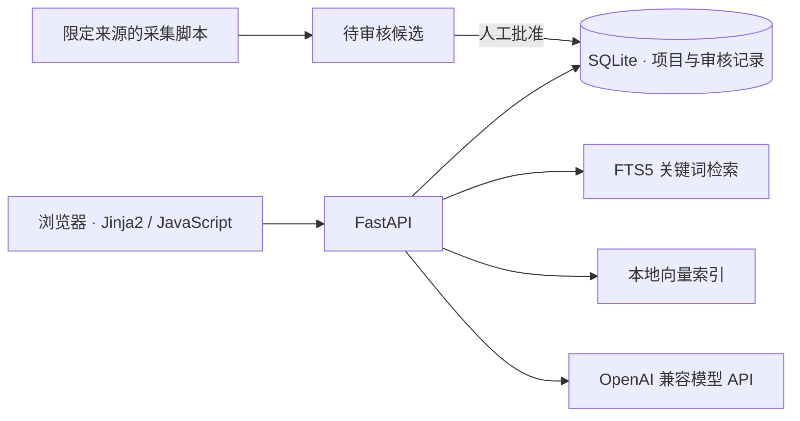

# StudyCompass AI 留学项目检索

> 输入留学计划，检索项目、核对官网来源，并获得基于现有数据的推荐与问答。

[](https://www.python.org/)
[](https://fastapi.tiangolo.com/)
[](https://www.sqlite.org/fts5.html)
[](#测试与评测)

## 项目简介

StudyCompass AI 是一个以 Python 为主的留学项目检索网页。用户可以用自然语言描述背景和目标，也可以按地区、学位、专业、成绩、预算、入学季和数据来源筛选项目。项目结果附有来源链接、更新时间和规则匹配说明；AI 推荐与问答只使用当前数据库中的项目事实。

数据库首次启动会载入**明确标记为模拟数据**的示例项目。官网信息只有经过来源权限核查和人工审核后才进入检索库，并逐项展示已采集的事实与证据。项目目前可在本地运行，适合功能验证和申请资料初筛；数据不保证完整或实时，也不代表录取承诺。

## 产品能力

### 项目检索与详情

- 自然语言检索、结构化筛选、分页和排序；结果区分“模拟项目”与“官网已核对”项目。
- SQLite FTS5 负责英文关键词检索，中文使用参数化子串匹配；本地向量负责近似文本召回。
- 结果页和详情页展示项目来源、官网采集时间、人工核对时间、字段缺失和待复核提醒。
- GPA 分制只做粗略换算；预算币种不一致时不进行汇率推算。规则匹配分不是录取概率。

### AI 推荐与项目问答

- 先解析需求，再检索项目并按规则评分，最后由配置的 OpenAI 兼容 API 选择推荐依据。
- 服务端核验 AI 引用的项目 ID 和字段值；无依据的问题回答“根据当前检索结果无法确定”。
- AI 超时、限流、输出无效或服务不可用时保留检索结果，并提示“AI 推荐暂不可用”。
- API Key 只保存在服务端 `.env`，页面不会读取密钥。

### 官网数据审核

- 来源目录限定可请求的官方 HTTPS 页面；同步前核对来源用途登记、有效期和 `robots.txt`。
- 采集仅生成候选和简短字段证据，不自动覆盖已展示项目。审核页可核对旧值、新值、适用条件和官网链接，再批准或驳回。
- 学费、语言要求、入学季和申请轮次分别保留证据；申请轮次不被写成项目唯一截止日期。
- 可选的每周同步任务只提出待审核变化，管理员仍需逐项复核。

### 历史记录与隐私

- 搜索、推荐和问答历史默认关闭，用户主动开启后才保存到本站 SQLite 数据库。
- 支持删除单条、清空全部、关闭保存并删除全部；记录保留 90 天。
- 浏览器保存 HttpOnly 随机凭证，数据库仅保存其摘要，不保存客户端 IP。常见邮箱、手机号和身份证号入库前会被遮盖，但不能保证识别所有敏感信息。

## 系统架构



查询先应用结构化条件，再结合关键词和向量结果排序。默认 `hash` 向量只提供轻量近似匹配；可选 `sentence-transformers` 本地模型提供语义向量。当前**未实现 BM25 分数融合或 CrossEncoder 精排**，也未使用 Chroma、FAISS 等独立向量服务。

## 技术栈

| 模块 | 技术 |
| --- | --- |
| 页面 | Jinja2、Tailwind CSS、原生 JavaScript、Fetch API |
| API | Python 3.11+、FastAPI、Uvicorn、Pydantic v2、slowapi |
| 数据 | SQLite、SQLAlchemy 2、Alembic、FTS5 |
| AI | OpenAI 兼容 API；默认示例配置为 DeepSeek |
| 向量 | SQLite `DocumentChunk`、Python 余弦相似度；可选 `sentence-transformers` |
| 测试 | pytest、FastAPI TestClient |

## 快速启动

### Windows 本地运行

在 `ai-study-abroad` 目录打开 PowerShell：

```powershell
Copy-Item .env.example .env
python -m venv .venv
.\.venv\Scripts\python.exe -m pip install -r requirements.txt
.\.venv\Scripts\python.exe -m alembic upgrade head
.\.venv\Scripts\python.exe -m uvicorn app.main:app --reload --no-access-log
```

### macOS / Linux 本地运行

```bash
cp .env.example .env
python3 -m venv .venv
.venv/bin/python -m pip install -r requirements.txt
.venv/bin/python -m alembic upgrade head
.venv/bin/python -m uvicorn app.main:app --reload --no-access-log
```

启动时应用也会自动运行 Alembic 迁移。空数据库会载入 `data/programs.json` 中的模拟数据，已有数据库不会因启动而清空。页面使用仓库内已构建的 `app/static/tailwind.css`，无需安装 Node.js；修改 Tailwind 类名后才需执行 `npm ci` 和 `npm run css:build`。

若当前 Python 环境无法创建虚拟环境，可临时将依赖安装到项目内：

```powershell
python -m pip install --target .deps -r requirements.txt
$env:PYTHONPATH = '.deps'
python -m uvicorn app.main:app --no-access-log
```

### 配置 AI 与向量模型

复制 `.env.example` 后，按需设置下列变量；密钥只放在 `.env`：

| 变量 | 用途与默认值 |
| --- | --- |
| `DATABASE_URL` | SQLite 数据库地址；默认项目目录内 `study_abroad.db` |
| `ALLOWED_ORIGINS` | 允许的浏览器跨域来源；默认空值 |
| `REQUEST_TIMEOUT_SECONDS` | 单次页面/API 请求超时；默认 60 秒 |
| `AI_API_KEY` | 模型服务密钥；留空时 AI 功能降级 |
| `AI_BASE_URL` / `AI_MODEL` | 默认 `https://api.deepseek.com` / `deepseek-flash` |
| `AI_TIMEOUT_SECONDS` | 单次模型调用超时；默认 25 秒 |
| `ADMIN_TOKEN` | 数据审核页和管理接口使用的随机令牌 |
| `VECTOR_BACKEND` | `hash`（默认）或 `sentence_transformers` |
| `VECTOR_MODEL_ID` / `VECTOR_MODEL_PATH` | 可选本地句向量模型名称与保存目录 |

可在 [DeepSeek 开放平台](https://platform.deepseek.com/)创建 API Key。配置后重启服务，调用 `POST /api/recommend`，查看响应中的 `data.ai_available` 是否为 `true`。AI 请求可能将用户输入和所选项目字段发送给模型服务商。

需要语义向量时，先安装可选依赖，在 `.env` 设置 `VECTOR_BACKEND=sentence_transformers`，再手动下载模型并建立索引：

```powershell
.\.venv\Scripts\python.exe -m pip install -r requirements-vector.txt
.\.venv\Scripts\python.exe -m scripts.build_vector_index --download-model
```

默认模型为 [多语言 MiniLM](https://huggingface.co/sentence-transformers/paraphrase-multilingual-MiniLM-L12-v2)。请先核对其使用条款。网页请求只读取本地模型；人工审核导入或离线更新项目后，重新运行 `python -m scripts.build_vector_index`。`hash` 后端会在应用启动及管理页批准项目变更后自动更新索引。

### Docker 状态

仓库目前**没有 Dockerfile 或 Docker Compose 配置**，请使用上面的本地命令运行。容器化部署属于后续工作。

## 常用地址

| 页面或接口 | 地址 |
| --- | --- |
| 正式首页 | `http://127.0.0.1:8000/` |
| 项目详情 | `http://127.0.0.1:8000/programs/1` |
| 数据审核页 | `http://127.0.0.1:8000/admin/reviews` |
| 交互式 API 文档 | `http://127.0.0.1:8000/docs` |
| 健康检查 | `http://127.0.0.1:8000/api/health` |

首页默认采用简洁列表样式；早期页面方案可在 `/preview/research` 和 `/preview/studio` 查看。

## 项目结构

```text
ai-study-abroad/
├─ app/
│  ├─ main.py                 FastAPI 应用与页面路由
│  ├─ routers/                检索、推荐、问答、历史和管理 API
│  ├─ services/               解析、检索、向量、审核与历史逻辑
│  ├─ sources/                限定官网来源与字段解析器
│  ├─ templates/              首页、详情页和审核页
│  └─ static/                 JavaScript、样式与构建后的 Tailwind
├─ data/programs.json        模拟项目种子数据
├─ migrations/               Alembic 迁移
├─ scripts/                  采集、核对、索引和定时同步脚本
├─ tests/                    API、审核和边界条件测试
├─ .env.example              环境变量示例
├─ requirements.txt          基础依赖
└─ requirements-vector.txt   可选语义向量依赖
```

## API 示例

所有 API 使用 `{ "code": 0, "message": "ok", "data": ..., "request_id": "..." }` 格式；错误也带相同字段和相应 HTTP 状态码。更多参数见 `/docs`。

```bash
curl http://127.0.0.1:8000/api/health
curl "http://127.0.0.1:8000/api/programs?q=computer%20science&retrieval=hybrid&page=1&page_size=10"
curl http://127.0.0.1:8000/api/programs/1
curl -X POST http://127.0.0.1:8000/api/parse -H "Content-Type: application/json" -d '{"query":"英国 CS 硕士 GPA 3.6/4 雅思7"}'
curl -X POST http://127.0.0.1:8000/api/recommend -H "Content-Type: application/json" -d '{"query":"英国 CS 硕士 GPA 3.6/4 雅思7","page_size":10}'
curl -X POST http://127.0.0.1:8000/api/chat -H "Content-Type: application/json" -d '{"message":"第一个项目的学费是多少？","program_ids":[1]}'
```

`GET /api/programs` 可用 `q`、`country`、`degree`、`discipline`、`gpa`、`ielts`、`budget`、`intake`、`ranking_max`、`source_type`、`retrieval`、`page`、`page_size` 和 `sort`。`page_size` 最多 100；排序仅接受 `relevance`、`deadline`、`updated_at`、`ranking`、`tuition_asc`、`tuition_desc`。`retrieval` 可选 `hybrid`、`keyword`、`vector`；响应中的 `retrieval_mode` 表示实际使用的方式。向量不可用时自动回退关键词检索。跨币种学费不能直接按价格比较。

历史接口包括 `GET /api/history`、`POST /api/history/consent`、`DELETE /api/history`、`DELETE /api/history/consent` 和 `DELETE /api/history/{search|recommend|chat}/{id}`。修改操作需携带 `X-History-Action: 1`；首页提供对应按钮。

## 官网数据采集与审核

### 固定来源与使用范围

| 来源 | 当前范围 | 处理方式 |
| --- | --- | --- |
| 剑桥大学 | 两条预设 MPhil 招生要求页 | 采集学历与语言要求，经核对后导入 |
| 香港城市大学、香港科技大学 | 六条预设课程页面 | 采集页面明示的语言或学费、入学季字段 |
| HKU、CUHK、Oxford、UCL | 候选课程页，默认关闭 | 来源用途登记有效且人工启用后才允许采集 |

示例官方入口包括剑桥大学的[高级计算机科学 MPhil](https://www.postgraduate.study.cam.ac.uk/courses/directory/cscsmpacs/requirements)和[科学计算 MPhil](https://www.postgraduate.study.cam.ac.uk/courses/directory/pcphmpscm/requirements)要求页、[香港城市大学计算机系](https://www.cs.cityu.edu.hk/academic-programmes/msc-computer-science/admissions)及[香港科技大学工程学院](https://seng.hkust.edu.hk/academics/taught-postgraduate/msc-it)课程页。具体使用范围须结合各站点当前条款逐站核查；可先查看[剑桥大学网站条款](https://www.cam.ac.uk/about-this-site/terms-and-conditions)和[港城大版权说明](https://www.cityu.edu.hk/web/copyright)。

脚本只请求来源目录内的官方 HTTPS 页面，先检查 `robots.txt`，保持请求间隔，不访问登录区或申请系统，也不保存网页全文。**`robots.txt` 允许访问不等于允许公开再利用内容**：本地非商业研究与公开展示需分别核实网站条款和授权。采集失败、权限过期或页面变化会留下待复核状态，不会自动覆盖已发布数据。

### 采集与核对后导入

以下命令在项目目录执行；本机确需代理时，采集脚本可使用 `--proxy http://127.0.0.1:3067` 指定本机回环 HTTP 代理。

```powershell
# 剑桥大学预设课程要求
.\.venv\Scripts\python.exe -m scripts.crawl_official_requirements --course all
.\.venv\Scripts\python.exe -m scripts.review_and_import prepare
# 核对 data/official_requirements/review.json 并批准后：
.\.venv\Scripts\python.exe -m scripts.review_and_import import

# 港城大与港科大预设项目
.\.venv\Scripts\python.exe -m scripts.crawl_additional_programs --course all
.\.venv\Scripts\python.exe -m scripts.review_additional_programs prepare
.\.venv\Scripts\python.exe -m scripts.review_additional_programs validate
.\.venv\Scripts\python.exe -m scripts.review_additional_programs import
```

核对清单默认不批准。管理员须逐项打开 `source_url`，核对数值、适用条件、简短证据及网站使用条款，再填写 `rights_confirmed`、`approved` 和审核说明。清单绑定采集快照；重新采集后不能沿用旧批准。采集文件与核对清单保存在 Git 忽略的 `data/official_requirements/`。英国学位等级不会被推断为 GPA，未采集的学费、截止日期和排名也不会用模拟值填充。

已有港校审核快照可在摘要仍一致时补入逐字段证据表；此操作不会重抓官网或改变检索值：

```powershell
.\.venv\Scripts\python.exe -m scripts.backfill_additional_evidence
```

学费证据须标明币种、学年和就读形式；语言要求须标明适用人群。多轮申请日期存入独立申请轮次表，不把某一轮日期当成项目唯一截止日期。“数据更新时间”表示最近采集时间，不代表官网页面发布日期。

### 来源权限、变更审核与每周同步

在 `.env` 设置 `ADMIN_TOKEN` 并重启服务后，打开 `/admin/reviews`。先逐站登记条款链接、核查日期、核查人及允许用途，再启用来源。管理 API 要求 `X-Admin-Token`，网页不会把 token 保存到浏览器持久存储。

```powershell
# 手动同步已启用且权限有效的来源
.\.venv\Scripts\python.exe -m scripts.sync_program_sources --all
# 只检查一个来源
.\.venv\Scripts\python.exe -m scripts.sync_program_sources --source hku-msccs-application
```

首次发现的项目、字段变化和申请轮次都会进入审核队列。审核页展示旧值、新值、适用条件、官网短证据、采集时间和审核记录；批准前不改变公开检索结果。采集失败或证据超过 90 天未复核时，页面会提示核对。

Windows 可显式注册当前用户的计划任务，每周一 08:00（Asia/Shanghai）运行同步；注册前需确认系统时区为 `China Standard Time`：

```powershell
powershell -NoProfile -ExecutionPolicy Bypass -File .\scripts\register_weekly_sync_task.ps1
# 停用计划任务：
powershell -NoProfile -ExecutionPolicy Bypass -File .\scripts\remove_weekly_sync_task.ps1
```

定时任务不会随应用启动自动安装。运行结果在管理页和 `logs/source-sync.log` 查看；同步器只提出候选，人工审核仍是发布数据的必要步骤。

Linux 可使用 `flock` 防止任务重叠，并在用户 crontab 中指定上海时区。将下面路径替换为实际部署目录：

```cron
TZ=Asia/Shanghai
0 8 * * 1 cd /srv/studycompass/ai-study-abroad && /usr/bin/flock -n /tmp/studycompass-source-sync.lock /srv/studycompass/ai-study-abroad/.venv/bin/python -m scripts.sync_program_sources --all >> /srv/studycompass/ai-study-abroad/logs/source-sync.log 2>&1
```

## 测试与评测

```powershell
.\.venv\Scripts\python.exe -m pytest tests -q
node --check app\static\app.js
```

测试覆盖健康检查、搜索筛选与分页、AI 失败降级、向量检索、官网数据审核、历史同意与删除等流程。`node --check` 只检查 JavaScript 语法，未安装 Node.js 时可略过。当前仓库尚无独立的检索效果评测集；新增模型或排序策略时，应使用实际查询与人工判断的相关性样本评估。

## 安全设计

- 项目字段和官网证据须来自已发布数据库；AI 输出经过项目 ID 与字段值校验，不接受虚构项目事实。
- 用户输入有长度和格式校验；SQLAlchemy 查询参数化，页面使用 Jinja2 自动转义及 JavaScript `textContent`。
- 普通接口与 AI 接口分别限流；跨域来源默认不开放。日志不记录 API Key、完整搜索词或完整问答内容。
- 管理接口通过 `ADMIN_TOKEN` 保护；公开展示权限独立于本地研究权限。
- 历史记录默认关闭，访问凭证只存在浏览器 Cookie，记录可删除并按 90 天保留期限清理。删除不自动清除已有数据库备份。

## 当前状态

| 已实现 | 仍需完善 |
| --- | --- |
| 本地网页、项目详情、搜索、规则评分、AI 推荐与问答降级 | 更大规模且逐站确认再利用权限的官网数据 |
| 固定来源采集、逐字段证据、人工审核与可选每周同步 | 面向公开服务的部署与运维配置 |
| SQLite FTS5、轻量向量检索、可选本地句向量模型 | BM25 分数融合、Rerank 精排与检索效果评测 |
| 主动同意的历史记录与删除 | 跨设备账号及历史同步 |

## 相关文档

- [环境变量示例](.env.example)
- [基础依赖](requirements.txt)与[可选向量依赖](requirements-vector.txt)
- [API 交互文档](http://127.0.0.1:8000/docs)（本地服务启动后可访问）

## 许可证

仓库目前未提供开源许可证文件。代码公开可见不代表自动获得复制、分发或商业使用授权；如需复用，请先联系仓库所有者确认许可。

## 免责声明

模拟项目及 `example.org` 链接不能用于正式申请。官网已核对项目只覆盖明确采集并经人工批准的字段。所有数据仅供参考，不保证录取；费用、要求、轮次和截止日期请以项目官网最新信息为准。
